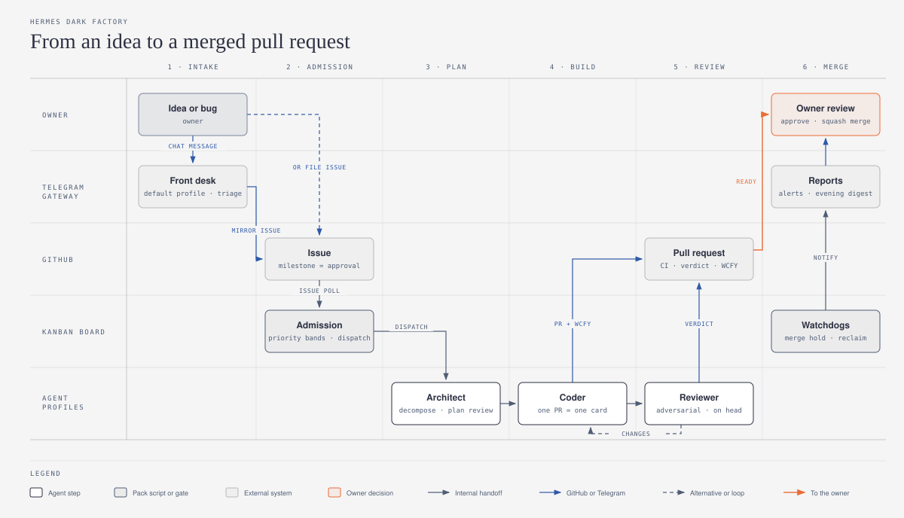

# hermes-dark-factory

An extension pack for [Hermes Agent](https://hermes-agent.nousresearch.com/) (v0.23.1) that turns a set of Hermes profiles into a small autonomous software factory: agents in the roles of orchestrator, architect, coder, reviewer, tester and ops work a kanban board, open pull requests, review and test each other, and hand finished work to a human owner who reviews, merges and teaches them.

The pack contains only what sits on top of Hermes. Hermes itself is installed and upgraded upstream and is never patched.

## How it works

| Stage | Who is responsible | What happens |
|---|---|---|
| 1. Intake | Owner, Telegram gateway (`default` profile), GitHub | The owner writes an idea or a bug to the bot in Telegram. The front desk turns the message into a triage card and mirrors it to a GitHub issue (`issue-mirror` skill). The owner can also file the issue directly, and scheduled agent jobs file issues that wait for the owner's triage. |
| 2. Admission | GitHub milestone, board scripts and plugins | Putting an issue into the active milestone is the owner's approval. The issue executor poll gives an approved issue exactly one executor card, the admission gate parks work nobody approved, and the admission plugin stops the dispatcher from claiming it in between. Priority comes from the milestone band; the dispatcher claims ready cards in priority order and pauses during the provider's peak window if configured. |
| 3. Plan | `architect` | Large work is decomposed into self-contained child cards, each owning one pull request. A large or critical plan goes to the `reviewer` through the native review lane before any child runs. |
| 4. Build | `coder` | The card works in its own worktree, pushes a branch as the bot account and opens the pull request. Before asking for review it posts a "What changes for you" comment: what the user of the product will notice. One PR = one card: rework and rebases happen on this same card. |
| 5. Review | `reviewer`, `tester`, GitHub | The reviewer tries to refute the work and posts `## Review verdict` on the exact head; changes requested send the work back to the same card. Where the plan has a QA step, the tester verifies the real diff. CI must be green on that head. |
| 6. Merge | Owner, watchdogs, Telegram gateway | The owner reviews and squash-merges; a formal review with changes reaches the card through the GitHub webhook. Watchdogs keep a signal on closed cards waiting for the merge, return runs whose worker died, and report through the gateway: hourly findings, quota alarms and an evening spend report. |

## What is inside

| Path | Contents |
|---|---|
| `pack/skills/` | Generic skills for the roles: kanban discipline, worker runs, decomposition, adversarial review, tester verdicts, PR deliverables, issue mirroring, debugging, lesson capture and more. Point `skills.external_dirs` at this directory. |
| `pack/souls/` | Role personas (SOUL.md) for each profile. |
| `pack/plugins/` | Hermes plugins: review-loop guard, artifact guard, admission guard (keeps unapproved cards from being claimed between two admission runs), disk-cleanup override. |
| `pack/config/` | A config overlay with the settings that cut model spend roughly in half. |
| `pack/scripts/` | The mechanical layer: watchdogs, gates, guards and metrics, configured through one `factory.env` file, with their tests and a hermetic test runner. |
| `pack/cron/` | The scheduled jobs the factory runs, as a reference list, and the prompts of the agent jobs. |
| `reference/githooks/` | Git hooks the agents' commits pass through (identity, link and style guards). |
| `docs/` | How it all works. |

## Read in this order

1. [docs/owner-journey.md](docs/owner-journey.md): what the owner of the factory does day to day.
2. [docs/how-hermes-works.md](docs/how-hermes-works.md): the Hermes internals that matter for a factory.
3. [docs/architecture.md](docs/architecture.md): how the factory is built on top of them.
4. [docs/extensions-catalog.md](docs/extensions-catalog.md): every mechanism we added, and why the native feature was not enough.
5. [docs/config-and-quota.md](docs/config-and-quota.md): spend and the knobs that control it.
6. [docs/operations.md](docs/operations.md): running it on a small server.
7. [docs/teaching-hermes.md](docs/teaching-hermes.md): correcting the agents through their own channel.
8. [docs/separation-and-adoption.md](docs/separation-and-adoption.md): generic versus project-specific, and moving an existing setup onto the pack.
9. [docs/lessons-learned.md](docs/lessons-learned.md) and [docs/install.md](docs/install.md).
10. [docs/adapting-to-your-project.md](docs/adapting-to-your-project.md): adapting, verifying, debugging and changing the pack for your own project (the agents' procedure is the `factory-adoption` skill).

## Status

Extracted from a factory that has been developing a real open-source project for several months, and kept in sync with that installation. The skills and docs are generic. `pack/scripts/` holds every script of the original setup, including the board watchdog, the worker-run watchdog, the issue executor poll, PR hygiene and the evening metrics, with project values moved into one `factory.env` file and more than a hundred test files that `run-tests.py --audit` runs in isolation.

The pipeline follows the rule "one PR = one card": the card that owns a pull request carries it through the native review lane up to the owner's merge, and no separate reviewer, rebase or summary cards are created for it. Every card that a script generates first asks whether a native mechanism or a live card already covers the work, and carries that receipt in its body.

The three large scripts (`board-watchdog.py`, `pr-hygiene.py`, `metrics-evening.py`) still encode one owner's rules and include irreversible actions (archiving cards, closing issues, rewriting the dispatcher cap). Start them with their dry-run flags and read what they would do on your board before you enable their cron jobs.
