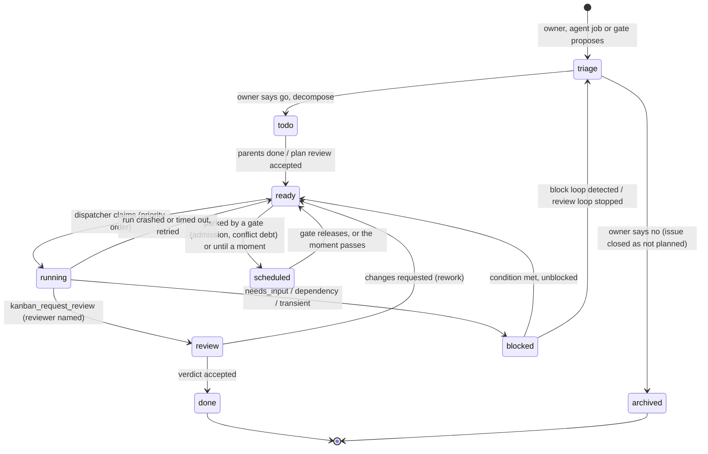
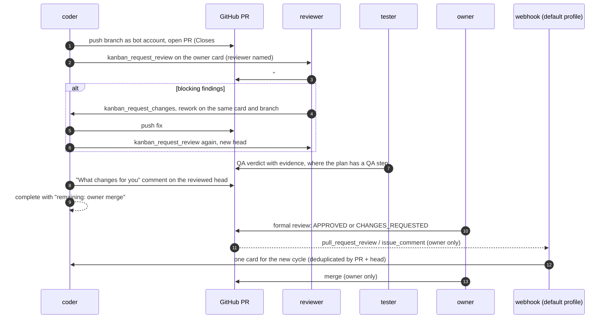
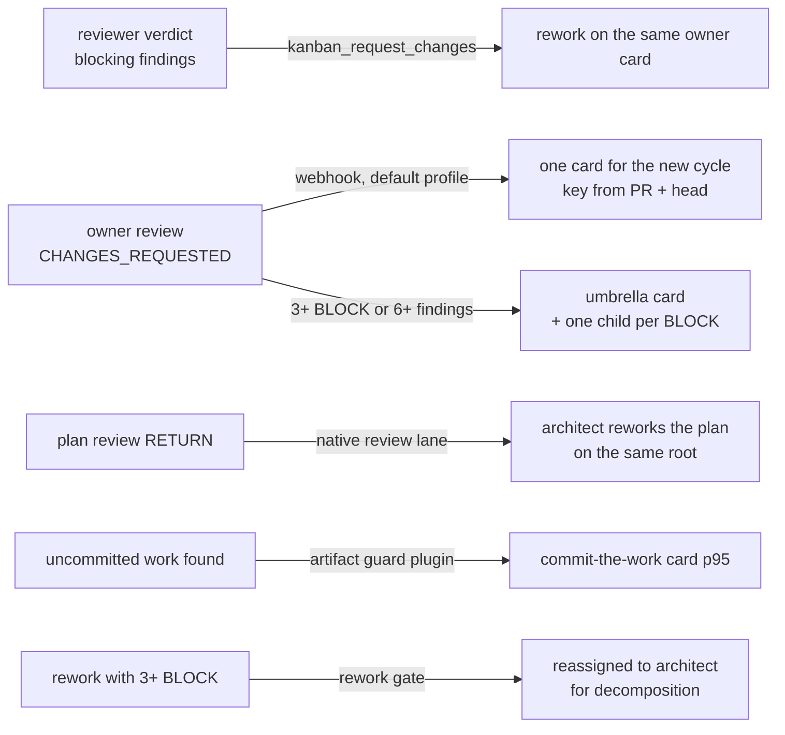

# Architecture of the factory

This document describes how the factory is built on top of Hermes: the six roles and how their models and reasoning effort are chosen, the life of a card from intake to merge, the pull request flow between coder, reviewer, tester and owner, who creates rework cards and when, the rules every card generator obeys, the watchdogs that keep worker runs and the board honest, the gates that keep decisions with the human owner, and the metrics and reports that tell the owner whether the factory is healthy. Hermes mechanics referred to here (statuses, links, dispatcher, hooks) are explained in `docs/how-hermes-works.md`; the individual add-on mechanisms are catalogued in `docs/extensions-catalog.md`.

## Design principles

1. **Hermes does the scheduling, the factory adds rules.** The board, the dispatcher, worker runs, cron, webhooks and notifications are native. Everything the factory adds is a script, a plugin, a skill or a config value. The Hermes core is never patched; when a native mechanism is missing, the add-on is recorded with the reason (see the catalog), and it is removed once upstream ships an equivalent.
2. **Verify the artifact, not the report.** A worker's summary is its words about the work. Every handoff is checked against something machine-readable: the branch diff, `git status --porcelain`, `gh pr checks`, the PR thread on the exact head sha.
3. **Mechanisms instead of written rules.** A rule that lives only in a SOUL or skill is broken sooner or later under budget pressure. Rules that matter become gates: a hook, a watchdog check, a plugin.
4. **The owner decides, the factory proposes.** Agents never merge, never accept their own work, and never resolve questions that belong to the owner. They block with `needs_input` and a concrete question.
5. **Alerts only on problems.** Silence means healthy. Every watchdog prints nothing when there is nothing to say.

## Roles

| Profile | Role | Model tier | Reasoning effort | Turn cap |
|---|---|---|---|---|
| `default` | owner's chat front desk; triage; webhook handler for owner reviews; home of most cron jobs | strong | medium | 200 |
| `architect` | orchestrator (`kanban.orchestrator_profile`): decomposes triage cards into self-contained children, writes plan documents, reworks plans after review | strong | max | 120 |
| `coder` | implements cards in a workspace, opens PRs as the bot account, never merges | cheap, with a stronger fallback | high (set as a per-model override) | 200 |
| `reviewer` | adversarial reviewer of plans and PRs: tries to refute the work, every finding with evidence | strong | high | 120 |
| `tester` | verifies the real diff and behaviour of the PR head, runs hidden acceptance scenarios | cheap | low | 200 |
| `ops` | host and service operations, incident cards, the peak-pause tick | cheap | low | 120 |

Why this split: the cost of a mistake decides the tier. A flawed plan multiplies across every child card, and a missed defect in review reaches the owner, so architect and reviewer keep the strong model. Code is written and rewritten many times and is checked by two later stages, so the coder runs on the cheaper model at high effort. Testing and operations are mostly mechanical commands with verifiable results, so they run cheap and shallow. The compression helper and other auxiliary calls run on the cheap model at low effort everywhere. The numbers behind these choices are in `docs/config-and-quota.md`.

Each role's behaviour is defined in its `SOUL.md` (identity, what to read before work, which skill to open for which situation, hard prohibitions) and its procedures in shared skills (`pack/skills/`). Language rule: agents talk to the owner in the owner's language, and write everything that lands in GitHub in the repository's language.

## Card lifecycle

### Intake

Work enters the board in four ways:

- the owner asks in chat ("add a task ..."): the default profile creates a `triage` card and mirrors it to a GitHub issue;
- a scheduled agent job (UX audit, weekly product or technical review) files issues that await the owner's triage;
- a watchdog, poll or plugin creates a card for a detected need (an approved issue without an executor, uncommitted work), always with an idempotency key and a native-or-live receipt (see below);
- the owner reviews a PR: the webhook turns the verdict into rework cards.

Agent-initiated cards stay in `triage` until the owner raises them or they belong to an open milestone. Only work the owner approved (an issue in a milestone, or one with the triage label removed) is admitted to the work statuses; see "Admission and priority bands" below. A daily digest lists the triage queue for the owner.

### From triage to done

Owner decisions on a triage card are recognised by meaning, not by exact words: "go" removes the triage label and runs `decompose`; "no" closes the mirrored issue as not planned and archives the card; "investigate" keeps the card in triage, and the agent researches the question and rewrites the issue for a second decision.

### Decomposition and plan review

The architect decomposes a root into children, each self-contained (context, file paths, acceptance criteria, how to verify), with facts about the repository checked in code rather than recalled. Hermes dispatches children immediately after decomposition, so the factory requires a plan review first: a root with more than three children, or one that touches a critical area (authentication, security, migrations, CI or build configuration, release lines), is handed to the `reviewer` through the native review lane (`kanban_request_review` on the root) before its children run. The verdict is read from the start of the review summary (`ACCEPTED` or `RETURN`); a return goes back to the architect on the same root. Separate "Plan review" and "Re-review" cards are not created, because they duplicate the review lane. The older `plan-review-gate.py`, which created such cards and capped the cycles at two, now runs in drain mode: it only services cycles that were already open.

### Workspaces and branches

Each card runs in its own workspace (`kanban/boards/<board>/workspaces/t_<id>/`), usually a git worktree of the main clone. Rework on a PR verdict is committed to the branch of that PR, not to a new stacked PR. Worktrees of finished cards are removed by `worktree-gc` only when the card is terminal, the branch has no open PR, all commits are on the remote and the tree is clean.

## Pull request flow

Key rules along the flow:

- **One PR = one card.** The card that opened a PR owns it until the owner merges. Review, rework after a reject and a rebase all happen on that card through the native review lane; the factory creates no separate reviewer, rework, rebase or summary cards for a PR. Earlier versions armed reviewer cards per head from a watchdog and paired them with summary and safety cards; those cards raced the native review lane and produced duplicate reviews of the same head, so they were removed.
- **The coder opens, never merges.** Completion of a card with a published PR requires green checks (native PR completion contract), and the contract reads `metadata.published_pr`, which must hold the full PR URL rather than a bare number.
- **A closed card keeps an owner-merge signal.** A card closed with "remaining: owner merge" is held by a watchdog gate: it keeps a finding for the owner and a comment with the release condition until the PR is merged.
- **Rebase only when needed, on the owner card.** A PR is rebased only when it is conflicting (or the owner asks), once, by the card that owns it. When PR hygiene sees that a base moved, it comments on the live owner card; a separate rebase card appears only when no owner card exists, and it is retired once the PR is mergeable again.
- **Reviewer verdicts are comments, not formal approvals.** The bot account that opens PRs cannot approve them, so the reviewer posts a comment headed `## Review verdict` (or `## Re-review verdict`) that names the head sha. A verdict on any other sha, or on a local build with extra cherry-picks, does not count.
- **Re-review re-checks behaviour.** Confirming that previous findings were addressed is not a review: changed behaviour is tested again on live scenarios. A PASS on a commit that is not newer than an open CHANGES REQUESTED is invalid.
- **Tester works on the real head.** An empty diff behind a claimed change is an automatic return. A QA PASS over an open reviewer request for changes is not allowed. UI changes carry before/after screenshots in the PR thread.
- **The owner's review is the only approval that matters**, and only the owner merges.

### Who creates rework cards

- **Reviewer returns** use the native review lane (`kanban_request_changes`), and the rework happens on the same owner card. After the third return on one chain, the review-loop guard blocks the card with `needs_input` for the owner.
- **Owner reviews** arrive through the webhook. Before creating a card, the handler looks for a live card with the same PR number and head sha and comments on it instead of creating a duplicate. If the owner card is already closed, one new card opens for the cycle, decomposed from the latest verdict of all reviewers (the head may already have closed older blockers). A verdict with three or more blocking items, or six or more findings in total, becomes an umbrella card plus one child per blocking item, because a single run cannot carry that much. Every card gets an assignee by the nature of the work, the priority band of its issue and an idempotency key derived from PR and head. A verdict with nothing left to do is recorded and closed right away.
- **Plan returns** go back to the architect through the review lane.
- **Gates** create catch-up cards only where nothing native or live covers the work: the artifact guard for uncommitted work, the rework gate reroutes oversized rework to the architect for splitting and lifts rework of an open PR into the active priority band.

## Rules every card generator obeys

### Native or live first

Before any script, prompt or agent creates, reassigns, restores or removes a card, it asks whether a native Hermes mechanism or a live card already covers the work: the review lane after `kanban_request_review`, native respawn and its guards, task links and dependency waits, an existing verdict on this head, a live card with the same key. If one does, nothing is created; the existing card is extended or awaited. In the scripts this rule is one helper, `board_native_guard.native_or_live`, which every card generator must call. Its receipt goes into the body of the card it allows, so a reader can see what was checked, and a static test fails the suite when a new generator skips the helper. Webhook prompts get the same receipt from the helper's CLI.

### Admission and priority bands

The board watchdog runs an admission gate: a card may sit in a work status only if it, or one of its ancestors, refers to an issue or PR the owner approved. Unapproved cards are parked with `kanban schedule` and a marker, and come back when the issue is approved; links of a decomposition chain are not treated as duplicates. Because the gate runs on a schedule, the `kanban-admission-guard` plugin closes the gap in between: right before the dispatcher spawns a worker, it checks the same approval cache and parks the card if nothing it refers to is approved.

Priority is not chosen from memory. `milestone_bands.py` computes bands from the open GitHub milestones on every run: the active milestone 80, the next one 40, anything else 20, and 100 for bringing an open PR to merge. A card's band comes from its own anchor (its issue, or the anchors of its ancestors), never from an issue mentioned in passing. Every path that creates a card, including webhook prompts, takes the band from the helper.

### Every approved issue gets an executor

`issue-executor-poll.py` runs every five minutes and makes sure every issue of the active milestone has an executor card within one cycle, in the milestone's band. It skips issues whose work is already delivered (a merged PR that references the issue and was merged after its last scope change) and anything a native mechanism or a live card covers. Delivered work that is still open and is not a release chore becomes a question to the owner, not a card.

### Parking and waiting

There is one way to park a card until a moment: `hermes kanban schedule` with `SCHEDULED_UNTIL=<UTC>` in the reason, which `worker-api-watchdog.py` executes when the moment passes. Transient blocks are not used for parking: two of them in a row move a card with run history into triage, where the auto-decomposer rewrites it from its stale body. A card that waits for a PR merge is blocked with `needs_input` and one machine-checkable release line (`PR #N merged`); the watchdog unblocks it once GitHub reports the PR merged, because the native dependency wait does not cover external events.

## Watching live runs

`worker-api-watchdog.py` runs every ten minutes and looks at every `running` card. It reports a run whose client is alive but whose model calls stopped, and a run that compresses its context again and again. A run that only polls GitHub, waiting for someone else's verdict, merge or CI, is parked with `kanban schedule` on a repeated finding, because a run must hand off instead of waiting. It also catches a card claimed for review by the same profile that delivered it, and a second review of a head that is already in review.

Finally, it reclaims orphaned claims: a card still `running` whose worker process is gone and whose heartbeat is stale. The dispatcher has its own reclaim phase, but the dispatch hold that the factory uses for quota stops and the peak-pricing pause silences the whole dispatcher tick, reclaim included. Without the watchdog, a worker killed together with the gateway kept its slot for as long as the hold lasted.

Running cards are never preempted: Hermes has no pause API, and `reclaim` kills the run. An hour of waiting for a slot is cheaper than throwing away an hour of a worker's progress.

## Owner gates

The factory is designed so that the owner's attention goes only where a human decision is needed.

- **`needs_input` blocks.** Any wait for a human or an external event is a `needs_input` block with a "Condition to unblock" line. A gate checks that agents do not park their own technical steps on the owner: updating a branch, waiting for required checks or re-running CI are agent work done with the bot's permissions; only the merge belongs to the owner.
- **Deterministic risk labels.** `pr-risk.py` assigns `risk:critical`, `risk:normal` or `risk:trivial` from diff facts and path rules, without an LLM. The class decides how closely the owner looks at a PR; the reviewer does not get to decide whether its own work needs checking. A shadow mode compares the rules against the owner's past verdicts so the rules can be calibrated.
- **Merge only by the owner.** Workers have no merge path, and the SOULs forbid it. Release decisions, scope decisions and anything "only the owner can close" are never blocking findings for the reviewer: it may not loop a worker over someone else's decision.
- **Prototype before implementation** (optional). For a new feature, the first deliverable is a prototype in the issue's before/after section; implementation cards stay blocked until the owner comments that the prototype is accepted. Only the owner's comment counts.
- **Hidden acceptance scenarios** (optional). The tester keeps holdout scenarios in a directory that coder and reviewer must not read, and runs them nightly against open PRs. Any access to that path from another role is reported to the owner.
- **Dispatch stops.** The owner can stop dispatch with a labelled hold that no script will release; quota and peak-hour stops never override it.

## Metrics and reporting

| Report | Source | When | What the owner learns |
|---|---|---|---|
| Health alerts | `hermes-health.py` | every 10 minutes, only on problems | provider or quota failure, dispatch stopped, cron jobs failing, orphaned stands, doctor alerts for providers in use, scripts changed since the last green test run |
| Run alerts | `worker-api-watchdog.py` | every 10 minutes, only on findings | silent or thrashing runs, poll-only runs, self-review and duplicate review, orphaned claims; findings go to the card |
| Board alerts | `board-watchdog.py` | hourly, only on problems | dispatcher dead or silent, graph stuck on blocked roots (with how many cards each root unblocks), cards without assignee, PRs waiting for review or for the owner's merge, gate actions |
| Card events | native notify subscriptions | per event | a card completed, blocked, asked for review or crashed |
| Per-card spend | `usage-ledger.py` | nightly, as a card comment | how much each finished card cost |
| Evening report | `metrics-evening.py` | daily | spend in provider units by profile and model; path from card to merge; rework rounds per PR; escaped defects (found by the owner after reviewer PASS); shares of run outcomes (completed, timed out, rate limited, crashed); average context per call, cache misses and compressions; waiting discipline (blind sleeps); retro facts |
| Reviewer misses | `reviewer-misses.py` | with the evening report | each reviewer PASS that the owner overturned on the same or next sha; the journal feeds the review skill |

The metrics exist to drive changes, and each optimisation is judged on a metric and an invariant together: for example spend per closed card, together with the number of cards closed and the owner's rework rate. A cheaper day with fewer merged PRs is not a win.
