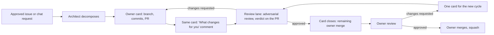

# The owner's journey

This document is for the person who runs the factory: the owner of the repository the agents work on. It walks through a working day: how work gets onto the board, what the agents do with it without you, what reaches your phone, where your decisions are needed, how you review and merge as owner, and how you correct the agents when they get something wrong. The technical background is in [how-hermes-works.md](how-hermes-works.md) and [architecture.md](architecture.md); this document only describes what you see and do.

## 1. The shape of the job

You are not a developer in this setup. You are the product owner and the last line of review. The agents write code, open pull requests, review each other, run QA on a test stand and write the "What changes for you" summary. You decide what gets built, which pull requests merge, and which lessons the agents must learn.

Three rules shape everything below:

1. **Only you merge.** The agents may approve each other, but the merge button belongs to the owner account. A repository ruleset enforces it, so a confused agent cannot merge by accident.
2. **An agent's report is not evidence.** "Approved", "PASS" or "tests green" from an agent is a claim. You check the artifact: the diff, the test that should fail when the fix is reverted, the live behaviour in a browser.
3. **You teach through the chat, not by editing their files.** When an agent does something wrong, you tell it what happened and what you expect, and it decides which skill, persona or memory to update. Then you check the diff of its knowledge layer.

## 2. Getting work onto the board

There are four intake paths. All of them end as cards on the kanban board `<board>`.

| Path | When to use it | What happens |
|---|---|---|
| Telegram chat with the orchestrator | Ideas, bugs you noticed, "look into X" | The orchestrator (default profile) turns the message into a triage card mirrored to an issue, and subscribes your chat to the card's events. Once you approve the issue, it is decomposed into executor cards. |
| GitHub issue in `<org>/<repo>` | Anything that should stay visible to other people | Putting an issue into the active milestone is your approval: within a few minutes the issue executor poll gives it an executor card in the milestone's priority band. Issues outside a milestone wait for your triage. |
| Scheduled agent ticks | Product discovery without you | Daily UX audit, weekly CEO and CTO reviews look at the product and file issues that await your triage. Nothing is built from them until you approve one. |
| CLI on the server | Precise one-off work | `hermes kanban create "<title>" --assignee <role> --body "<details>"`. Useful when you want a specific role and priority. |

What makes a good card, whichever path you use:

- **A reproduction or a concrete observation**, not a solution. "Clicking Save with an empty name closes the form without an error" is better than "add validation".
- **An acceptance criterion** you can check yourself: what you will click and what you expect to see.
- **Scope boundaries**, if any: what must not change.

Large ideas go through decomposition. The architect splits the card into children, each of which owns one pull request, links them with parent/child dependencies, and hands a large or critical plan to the reviewer through the review lane before the children run. Children wait in `todo` until their parents are done; that waiting is normal and is not a sign that the card is stale.

Work you have not approved does not run. A card whose issue is not in a milestone and still awaits your triage is parked by the admission gate, and a plugin stops the dispatcher from claiming it in the minutes between two gate runs.

## 3. What happens without you

Once a card is `ready`, the dispatcher gives it to a worker of the right role, at most two at a time on a small server. A typical feature goes like this:



Things you will notice along the way:

- **One pull request, one card.** The card that opened a PR carries it through review, rework and a rebase if one is needed. You will not see separate reviewer or rebase cards for the same PR, and a closed card that only waits for your merge keeps a signal in the watchdog report until you merge.

- **Verdicts live on the pull request**, as comments starting with `## Review verdict`, with a `## Calibration` block that lists which promises were checked and which mutants were built.
- **Every PR gets a "What changes for you" comment** bound to the exact head commit: what the user of the product will notice, in plain words. If the head moves, a fresh one is required.
- **Visual before/after evidence lives in the issue**, at the prototype stage, not in the PR. This was an explicit cost decision: screenshot cards in every PR were the most expensive item in the budget.
- **A peak-hour pause** stops new dispatch while the model provider charges peak rates. Cards simply wait.
- **Priorities follow your milestones.** Cards of the active milestone run first, then the next one; bringing an open PR to merge comes before both.

## 4. What reaches your phone

The gateway delivers to `<telegram-chat>`:

- events of cards you created or subscribed to (completed, blocked, review requested and so on);
- the hourly board watchdog: stuck dispatch, cards blocked on you, closed cards waiting for your merge, issues of the active milestone without an executor, repeated failures;
- quota alarms: when the provider returns a quota error the health check stops dispatch and tells you;
- the evening report: tokens and credits spent, cards closed, the path from card to merge, and pull requests that are merge-ready.

If something is too noisy, change the delivery mode of the subscription rather than ignoring the channel. A notification you learn to ignore is worse than no notification.

## 5. Where your decisions are needed

Cards that need you end up `blocked` with a `needs_input` reason, or as pull requests waiting for owner review. The watchdog groups them for you. The usual kinds:

- **Product decisions**: scope of a feature, whether a finding is a bug or intended behaviour.
- **Risky pull requests**: the risk labeller marks pull requests `risk:critical` when they touch security, data, build or CI. The agents will not merge them and will not argue them through.
- **Conflicts between your written decisions and a new request.** The agents are taught to stop and ask when a chat request contradicts a decision you recorded earlier. Answer with a new explicit decision; they will not quietly override the old one.

Write your decisions down where the agents read them (the project conventions skill or a decisions reference file), with the date and the reason. A decision that lives only in a chat message will be forgotten after context compression.

## 6. Reviewing and merging as owner

Your review is the expensive, high-value step. Treat an agent "APPROVED" as the start of your review, not the end.

**Pick candidates.** A pull request is a candidate when its owner card has finished on the current head: a reviewer's approving verdict on that exact head (a QA verdict alone does not count), a "What changes for you" comment on that head, green CI, and no conflicts. Pull requests with conflicts get a request to rebase, not a review.

**Check the artifact, not the report.**

- For every blocker you raised before, find the production line that fixes it, revert just that line, and confirm a test turns red. A test that seeds the state the fix is supposed to write proves nothing.
- For every promise in the PR body and the "What changes for you" comment, find the test that would fail if the promise broke. A promise without such a test is a blocker: either pin it or drop the claim.
- For changes that move or delete user data, enumerate how a user can reach that code path, not only the scenario in the description.
- For visible behaviour, check it in a real browser with real input. A programmatic click bypasses overlays and pointer rules and does not count.
- For UI layout changes, look at the error, connected and empty states, not only the first load.
- For stacked pull requests, the lower pull requests must be reviewed or merged first.
- Statements about third-party projects (versions, issues, behaviour) are checked against the primary source.

Large reviews are a good job for a separate reviewing agent of your own (for example a coding assistant on your laptop) that gets your previous verdict and checks the head independently. Re-check its key findings yourself before publishing.

**Publish the verdict** as a formal review from the owner account, in English, in a fixed shape:

```
## Review verdict

CHANGES REQUESTED: normal (owner, YYYY-MM-DD, head <full sha>)

### Blockers
- [BLOCK] <what is wrong>, <file:line>, <how to reproduce>, <what would fix it>

### Closed and verified
- <previous item>: <evidence, e.g. "reverting the fix turns test X red">

### Minor
- <non-blocking notes>

### Owner decision
I will review again on a new head that closes the blockers, and I do the merge myself.
```

Two details matter more than they look:

- **Write the owner decision in the first person** ("I will merge after X"). Agents read imperative sentences ("merge as soon as X") as instructions and may act on them.
- **Bind the verdict to the head.** If the branch is rebased or pushed after your approval, your verdict no longer applies; review the new head.

A formal review triggers the webhook. The live card that owns the PR picks up the rework; if that card is already closed, one new card opens for the cycle (split into children when there are many blockers). You do not need to create cards by hand.

**Merge** with squash, pinned to the head you approved:

```
gh pr merge <N> --squash --match-head-commit <sha>
```

Then watch CI on the target branch until it is green. Close pull requests that the merged one supersedes, with a one-line comment saying which pull request replaced them.

## 7. Teaching the agents

When an agent's mistake reaches you (a wrong approval, a broken rule, a duplicate card, an expensive loop), turn it into a teaching round rather than fixing the symptom yourself. The method is in [teaching-hermes.md](teaching-hermes.md); in short:

1. Write the facts: what happened, with links and file:line, and what you expected instead.
2. Send it to the orchestrator in its chat and ask it to find the root cause in its own sessions, fix the right knowledge layer, record the miss and snapshot its layer.
3. Check the snapshot diff and, where possible, a live run that shows the new rule working.
4. Watch the next real case. A rule that exists but is not applied is a form problem: make it a mandatory part of the output (for example a table in the verdict) instead of adding a second rule.

Before you send a round, check your request against the decisions you already recorded. Your own memory of the rules can be older than your last decision.

## 8. Watching cost

The evening report shows spend per profile. Healthy signs: cost per closed card falls, the average context per model call stays well below the compression threshold, and the expensive model is used mainly by the reviewer and the architect. Warning signs: a single card running for hours, the same card retried many times, scheduled agent ticks on the expensive model, and your own teaching rounds dominating the orchestrator's spend. See [config-and-quota.md](config-and-quota.md) for the knobs.

## 9. A daily rhythm that works

- **Morning**: read the night's digest; answer `needs_input` cards; pick merge candidates.
- **During the day**: owner reviews of candidates; one teaching round per new kind of mistake, not per incident.
- **Evening**: read the report; check that nothing is stuck behind you; if you will be away, make sure no pull request is waiting on a decision only you can make.
